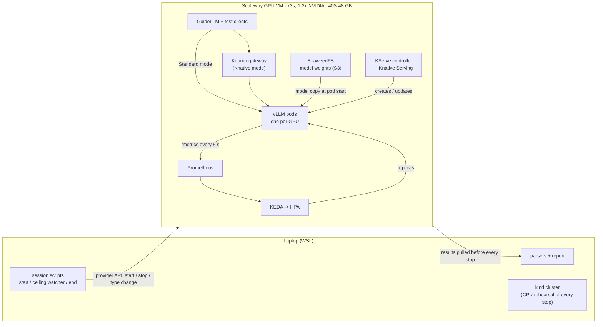
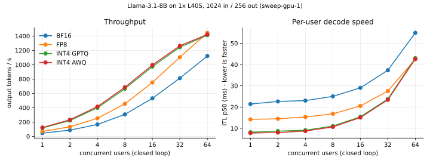
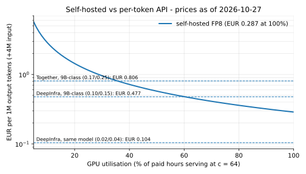
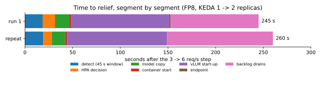

# Self-hosted LLM inference on NVIDIA L40S: quantization, autoscaling, canary and cost

*llm-serving-lab - benchmark report, 2026-10-27. Every number below is traceable
to a committed file; the source is named under each table.*

## 0. TL;DR

Llama-3.1-8B-Instruct on NVIDIA L40S GPUs, served by vLLM 0.29 under KServe on
Kubernetes; every number below is measured and traceable (section 2).

1. **The best weight format depends on load** (section 3). At one user, 4-bit
   (AWQ/GPTQ) generates tokens 1.8x faster than FP8. FP8 has the lowest time to
   first token at every load and the most throughput when busy (+17% on long
   prompts).
2. **On price alone, one rented GPU loses to the cheapest API - even at 100%
   busy** (section 4): EUR 0.287 vs EUR 0.104 per 1M output tokens. Against
   typical 9B-class prices, self-hosting breaks even at 36-60% utilisation.
   Utilisation moves cost ten times more than the choice of format.
3. **Autoscaling on vLLM's own metric relieves a load step in ~4-4.3 minutes**
   (section 5), half of it the new replica starting up - and on one machine it
   buys latency, not money.
4. **A cold start takes ~4.2 minutes, fully explained** (section 6): vLLM's
   start-up is 136-137 s, and ~50 s of every boot is a platform-ordering wait
   (a rejected pod, then KServe's webhook).
5. **A Knative canary on the GPUs: 0 errors in 4,336 requests**, ~2.6 s rollback
   and promotion, ~1 ms data-path overhead; wake from zero answers in ~2 minutes
   (section 7).

Total cost of the project: **EUR 43.56** - half of it disk and IP while the GPU
was off (appendix A.4).

## 1. What was built

A self-hosted inference platform on rented GPUs, run as a disciplined
experiment: the GPU machine exists only while a scripted session is open, and
every result is committed with the code that produced it.

**Stack (all pinned; images by digest).**

| layer | component |
|---|---|
| hardware | Scaleway fr-par-2: L40S-1-48G (1x L40S) for the single-GPU sessions incl. the format sweep; L40S-2-48G (2x L40S) for sessions 5-6 |
| node | Ubuntu 24.04 (Scaleway image "Ubuntu Noble GPU OS 13 passthrough", kernel 6.8), NVIDIA driver 580.126.20, k3s v1.36.4+k3s1, NVIDIA device plugin v0.20.0 |
| serving | KServe v0.20.0 (Standard mode by default), vLLM 0.29.0 (`vllm/vllm-openai@sha256:c2914767...`) |
| model storage | SeaweedFS (S3 API) inside the cluster; KServe copies weights into each pod |
| autoscaling | Prometheus v3.15.0, KEDA v2.21.0 (section 5) |
| canary / scale to zero | Knative Serving 1.21.1, Kourier 1.21.1, Envoy v1.36.13 (section 7) |
| load | GuideLLM 0.7.4; small standard-library clients for the Knative tests |
| rehearsal | kind (Kubernetes v1.36.4) on the laptop, vLLM CPU build, a Qwen 0.5B model |

**Discipline that shaped the results.** Every GPU step was first run end to end
on the laptop's kind cluster. Each GPU session is opened by a script that also
starts a watcher with a hard time ceiling, and closed by a script that confirms
the machine is stopped and records the bill. The whole project cost **EUR 43.56**
over six weeks against a self-imposed EUR 60 limit.

## 2. Method

**Held constant.** One vLLM configuration for every format and every test:
`--max-model-len=4096 --gpu-memory-utilization=0.80 --max-num-seqs=256
--max-num-batched-tokens=2048`, tensor parallelism 1, prefix caching at vLLM's
default (on). Flags live in one ServingRuntime; an InferenceService only names
the model, so a format comparison cannot accidentally change a setting.

**Load generation.** GuideLLM runs **on the GPU machine**, so laptop-to-cloud
network latency never enters a measurement. Two load models, used for
different questions:
- **Closed loop** (section 3): *c* users, each waits for its answer before
  asking again - measures capacity at a given concurrency. Ladder 1, 2, 4, 8,
  16, 32, 64 (long prompts: 1, 4, 16, 32), 300 s per point, the first 20 s of
  each point excluded (the first wave of prompts all arrive at once).
- **Open loop** (section 5): requests arrive on a fixed, seeded schedule
  whether or not earlier ones are done - measures how the system copes with
  load it does not control.

**Prompts.** Synthetic, generated per point from a seed, so no two prompts
share content: the prefix cache hit rate in section 3 was 3.0% (primary) and
1.0% (long prompts) - only the 34-token chat-template header. Tokens are
counted with the model's own tokenizer at a pinned revision. The section-7
canary test is the exception (one repeated prompt) and is labelled as such.

**Statistics.** Percentiles by nearest rank on per-request records; no
smoothing. A 60 s warm-up at c = 64 precedes each format. Run-to-run stability
is checked with an **anchor point** (FP8, c = 16) re-run on a fresh pod 2 h 13
min later: within 0.6% on every metric. Time-to-relief and cold-start
breakdowns use the cluster's own timestamps (1 s resolution for Kubernetes
events), with laptop-VM clock offsets measured at both ends of a session.

**Not measured.** Output quality (any format); hosted-API latency; multi-GPU
models (tensor parallelism); other GPU types; more than one machine;
Knative's request-based autoscaling beyond 0 <-> 1.

## 3. Quantization x concurrency

**Answer first.** For an interactive service with few concurrent users, 4-bit
gives the best per-user speed and the most KV-cache room; for a busy service, or
one with long prompts, FP8 gives the best time to first token and the most
throughput.

**Question.** For one 8B model on one GPU, what does each weight format buy in
latency and throughput, and how does the answer change with load?

**Terms used in this report.**
- **Prefill** - the model reads the whole prompt in one pass. Heavy on compute.
  It ends with the first output token.
- **Decode** - the model then generates one token at a time. Each step re-reads
  all the weights from GPU memory, so it is limited by memory bandwidth.
- **TTFT** (time to first token) - how long a user waits before the answer
  starts: queueing + prefill. **ITL** (inter-token latency) - the gap between
  output tokens after that: the decode speed one user sees.
- **KV cache** - per-request working memory on the GPU (the attention keys and
  values of every token so far). Whatever the weights leave free becomes KV
  cache; more cache = more requests served at once.
- **Closed-loop / open-loop load** - defined in section 2; in closed loop, *c* is
  the number of requests in flight.

**Setup (details in section 2).** Llama-3.1-8B-Instruct in four formats on one
NVIDIA L40S 48 GB, vLLM 0.29.0, identical server settings for every format.
Closed-loop load from GuideLLM 0.7.4 on the same machine, 300 s per point.
Two request shapes: **primary** 1024 prompt / 256 output tokens, and
**long-prompt** 3072 / 128. Concurrency, not batch size, is the variable:
vLLM's continuous batching makes the batch an output of the scheduler.

| leg | checkpoint (Hugging Face) | weights | KV cache (tokens) |
|---|---|---|---|
| BF16 | `meta-llama/Llama-3.1-8B-Instruct` | 16-bit | 154,176 |
| FP8 | `RedHatAI/Meta-Llama-3.1-8B-Instruct-FP8` | 8-bit float, W8A8 | 205,856 |
| INT4 GPTQ | `RedHatAI/Meta-Llama-3.1-8B-Instruct-quantized.w4a16` | 4-bit int, W4A16 | 232,464 |
| INT4 AWQ | `hugging-quants/Meta-Llama-3.1-8B-Instruct-AWQ-INT4` | 4-bit int, W4A16 | 232,768 |

Smaller weights leave more of the GPU for the KV cache: ~120 full requests'
worth at BF16, ~160 at FP8, ~181 at 4-bit.

### 3.1 Results - primary shape (1024 / 256)

| leg | c | TTFT p50 / p95 (ms) | ITL p50 (ms) | output tok/s |
|---|---|---|---|---|
| BF16 | 1 | 101 / 103 | 21.4 | 46 |
| FP8 | 1 | **73 / 74** | 14.2 | 69 |
| GPTQ | 1 | 87 / 90 | 8.2 | 118 |
| AWQ | 1 | 86 / 88 | **7.8** | **124** |
| BF16 | 64 | 553 / 736 | 54.9 | 1,121 |
| FP8 | 64 | **432 / 577** | **42.5** | **1,445** |
| GPTQ | 64 | 572 / 761 | 43.0 | 1,412 |
| AWQ | 64 | 569 / 758 | 42.7 | 1,422 |

c = 8 rows: appendix A.1. Output tokens/s across the whole ladder (c = 1, 2, 4, 8, 16, 32, 64):

| leg | 1 | 2 | 4 | 8 | 16 | 32 | 64 |
|---|---|---|---|---|---|---|---|
| BF16 | 46 | 87 | 166 | 307 | 531 | 812 | 1,121 |
| FP8 | 69 | 134 | 252 | 454 | 752 | 1,104 | 1,445 |
| GPTQ | 118 | 222 | 398 | 665 | 974 | 1,244 | 1,412 |
| AWQ | 124 | 232 | 415 | 686 | 996 | 1,264 | 1,422 |

*Source: `benchmarks/results/sweep-gpu-1/results.csv` (session 4, 2026-10-03).
TTFT = time to first token, ITL = inter-token latency, both client-side;
percentiles by nearest rank.*

### 3.2 Results - long-prompt shape (3072 / 128)

| leg | c | TTFT p50 / p95 (ms) | ITL p50 (ms) | output tok/s |
|---|---|---|---|---|
| BF16 | 1 | 277 / 280 | 21.8 | 42 |
| FP8 | 1 | **212 / 216** | 14.6 | 62 |
| GPTQ | 1 | 266 / 271 | 8.5 | 95 |
| AWQ | 1 | 266 / 269 | **8.1** | **99** |
| BF16 | 32 | 792 / 987 | 96.0 | 314 |
| FP8 | 32 | **623 / 776** | **76.0** | **396** |
| GPTQ | 32 | 817 / 1,018 | 88.7 | 337 |
| AWQ | 32 | 815 / 1,015 | 88.3 | 339 |

*Source: as above, shape2 rows (c = 1, 4, 16, 32).*

### 3.3 What the numbers say

1. **At low load, 4-bit decodes fastest.** At c = 1, AWQ generates a token every
   7.8 ms against FP8's 14.2 ms: 1.8x the per-user speed. A single stream is
   limited by reading the weights from GPU memory for every token, and 4-bit
   weights are the smallest. The advantage shrinks as load rises: at c = 8,
   4-bit still leads FP8 by ~50% in throughput; at c = 64 the gap is gone.
2. **FP8 has the lowest time to first token at every load, on both shapes**
   (c = 1: 73 ms vs 86-87 ms for 4-bit; long prompts: 212 vs 266 ms). The first
   token is dominated by prefill - processing the whole prompt at once - which
   is compute-bound. The L40S runs FP8 matrix maths natively; W4A16 formats keep
   16-bit activations and unpack their 4-bit weights on the fly.
3. **At high load FP8 also wins throughput - slightly on the primary shape, clearly
   on long prompts.** c = 64 primary: 1,445 vs 1,412-1,422 tok/s (+2%). Long
   prompts, c = 32: 396 vs 337-339 tok/s (+17%), with lower ITL too. The more
   prefill in the mix, the more FP8's compute advantage shows.
4. **GPTQ and AWQ are equal within measurement error.** They differ by 1-4%
   everywhere. Both run on the same Marlin W4A16 kernels in vLLM, and the GPU
   warmed slightly over the 2.5-hour sweep (c = 1 clock 2,510 MHz in the first
   leg, 2,474 MHz in the last, ~1.5%) - the same size as the gap, and AWQ ran
   last. Neither is claimed faster.
5. **BF16 is slowest everywhere and was not saturated at c = 64** (+38% from
   c = 32 to 64, still climbing). Its column is "throughput at c = 64", not its
   maximum - so the quantized formats' advantage over BF16 at full load
   (26-29% more throughput, i.e. 20-22% lower cost per token) is an upper bound.

### 3.4 Caveats

- **Speed only, not quality.** The two 4-bit checkpoints come from different
  publishers with different calibration; output quality was not measured here
  (future work, section 9). "4-bit" alone is ambiguous - every 4-bit
  number carries its algorithm label.
- **One card, one model size, one software version.** The crossover points are
  for L40S + vLLM 0.29.0 + an 8B model; a GPU with more memory bandwidth, or a
  larger model, moves them.
- **Run-to-run stability was checked, not assumed** - the anchor re-run
  (section 2) matched within 0.6%.
- **One unexplained point.** Long-prompt 4-bit TTFT p50 at c = 4 (714 ms) is
  higher than at c = 16 (589 ms). Most likely closed-loop lockstep: same-length
  requests finish together, return together, and their prefills queue. Not
  investigated further; it does not change any finding.

## 4. Cost per million tokens

**Answer first.** On price alone, renting one on-demand L40S to serve this model
loses to the cheapest per-token API - even with the GPU busy 100% of the time.
Against more typical API prices for a model of this size, self-hosting breaks
even only above roughly 36-60% sustained utilisation. Self-hosting a small model
is justified by things other than price: control of the model version, data
residency, latency guarantees, custom weights - or very high sustained load on
cheaper GPU capacity.

**Method.** Self-hosted cost = what the instance costs per hour while running ÷
the tokens it produces per hour. The hour rate is **EUR 1.494** all-in: compute
EUR 1.46988 + 150 GB volume EUR 0.0195 + IPv4 EUR 0.005 (Scaleway L40S-1-48G,
rates reconciled against the billing API, `benchmarks/cost-model.md`).
Throughput is section 3's c = 64, primary shape. **Utilisation** = the share of
paid hours the GPU spends serving at that load; an idle paid hour produces
nothing, so cost per token scales with 1 / utilisation.
The denominator is **1 million output tokens**. In the primary shape (1024 in /
256 out) each output token arrives with 4 input tokens, so a hosted API is
charged for **4M input + 1M output**: cost = 4 x input price + output price.

### 4.1 Self-hosted (measured)

EUR per 1M output tokens (with their 4M input tokens), by utilisation:

| leg | tok/s at c = 64 | 100% | 50% | 25% | 10% |
|---|---|---|---|---|---|
| BF16 (upper bound) | 1,121 | 0.370 | 0.740 | 1.48 | 3.70 |
| FP8 | 1,445 | **0.287** | 0.575 | 1.15 | 2.87 |
| INT4 GPTQ | 1,412 | 0.294 | 0.588 | 1.18 | 2.94 |
| INT4 AWQ | 1,422 | 0.292 | 0.584 | 1.17 | 2.92 |

*Valid at c = 64 latency: TTFT p95 0.58-0.76 s, ITL 42-55 ms (~18-24 tokens/s
per user). Source: `benchmarks/results/sweep-gpu-1/results.csv`, cost model.*

### 4.2 Hosted APIs (provider pages, fetched 2026-10-27)

| offer | price per 1M tokens (in / out) | EUR per 1M output (+4M input) |
|---|---|---|
| DeepInfra `Meta-Llama-3.1-8B-Instruct-Turbo` - **same model** (FP8) | $0.02 / $0.04 | **0.104** |
| DeepInfra `Qwen3.5-9B` - *different model, 9B-class market indicator* | $0.10 / $0.15 | 0.477 |
| Together `Qwen/Qwen3.5-9B` - *different model, 9B-class market indicator* | $0.17 / $0.25 | 0.806 |

*Sources: deepinfra.com/pricing; docs.together.ai/docs/serverless/models.md.
USD -> EUR at the ECB reference rate of 15 Sep 2026, 1.1539 (the latest found;
the 2026 range 1.13-1.18 moves any figure here by under 4%).*

Two market facts from the same check:
- **Llama 3.1 8B is being retired from per-token APIs.** Scaleway's Generative
  APIs and Together's serverless catalog no longer list it (older copies of
  Scaleway's page showed EUR 0.20 per 1M tokens; aggregator sites still quote
  $0.18 for Together). Only DeepInfra's offer was confirmed live on the
  provider's own page. Aggregator prices were out of date or mixed up model
  variants, so none are used here.
- **Managed dedicated serving costs more than doing it yourself.** Scaleway's
  managed deployment on the same L40S-1-48G lists **EUR 1.72/h**, 15% above this
  project's EUR 1.494 all-in - before the operational work, which is the point of
  paying for it.

### 4.3 Break-even

| self-hosted FP8 vs | break-even utilisation |
|---|---|
| DeepInfra, same model (EUR 0.104) | **never** - would need 276% |
| DeepInfra, 9B-class (EUR 0.477) | **60%** |
| Together, 9B-class (EUR 0.806) | **36%** |

*Break-even = self-hosted cost at 100% ÷ hosted cost.*

### 4.4 What the numbers say

1. **Utilisation moves cost ten times more than quantisation does.** Going from
   100% to 10% busy multiplies cost by 10; the best format beats BF16 by ~22%.
   The operational lever - keeping the GPU busy, or scaling it to zero when it
   is not (sections 5-7) - matters more than the format choice.
2. **A provider at scale wins on price for a popular small model.** They batch
   many customers' traffic onto large GPUs and keep them busy; one rented GPU
   for one workload cannot match that.
3. **Self-hosting has other reasons.** Pinning the model version (this very model
   is disappearing from APIs), keeping data in one jurisdiction, serving
   fine-tuned or private weights, and owning the latency budget are not on any
   per-token price list. At sustained high load on committed or cheaper GPU
   capacity, the price gap also closes.

### 4.5 Caveats

- **Latency is part of the price.** The self-hosted figures hold only at the
  c = 64 latencies above. Hosted-API latency was not measured here.
- **On-demand rates.** Reserved or committed GPU capacity, or a cheaper
  provider, lowers every self-hosted number; this report uses what was actually
  paid.
- **Quality not compared.** The hosted "Turbo" model is an FP8 build like this
  project's FP8 leg; the 9B-class rows are a different model entirely and only
  locate typical prices.
- **Prices move.** All hosted prices are as of 2026-10-27 and will change.

## 5. Autoscaling

**Answer first.** Scaling vLLM out on its own load metric works and repeats to
within ~6%: a step from 3 to 6 requests/s is relieved in **~4-4.3 minutes**.
Half of that is the new replica *starting*, not the decision to start it, so
faster detection can save at most ~30 s. On one fixed two-GPU machine this
buys **latency, not money** - the second GPU is billed whether it serves or not.
At 8 requests/s two replicas are not enough and there is no relief at all.

**Setup.** FP8 leg, Standard mode, one `llama-fp8` InferenceService on a node
with 2x L40S, min 1 / max 2 replicas. KEDA v2.21.0 reads Prometheus (5 s
scrape) and drives a Kubernetes HPA (15 s sync; scale-up immediate, scale-down
after 300 s). Load is **open-loop**: requests arrive on a fixed schedule
whether or not earlier ones have finished - like real users, unlike section 3.
Trace: 3 req/s for 180 s -> **6 req/s for 480 s** -> 3 req/s for 480 s,
1024 / 256 tokens. One FP8 replica saturates at ~5.5 req/s, so the step
cannot be carried by one replica.

**The scaling signal - running, not waiting.** The obvious queue metric,
`vllm:num_requests_waiting`, stays at ~0 until the KV cache is full: in the
format-sweep pilot, TTFT p50 was already 10.8 s while *waiting* still read zero. The
batch vLLM is actually working on, `vllm:num_requests_running`, tracks load
(mean 4 -> 10 -> 22 -> 91 at 1 -> 2 -> 4 -> 6 req/s). Rule:
`sum(avg_over_time(vllm:num_requests_running[45s]))`, **24 per replica** -
replicas = ceil(total / 24). 24 is a setpoint (the load one replica should
carry), not an alarm level; a 40-60 alarm level would oscillate on two
replicas at 6 req/s.

### 5.1 Time to relief, broken down

*Relief = the rolling TTFT p95 is back within 1.5x of its pre-step value after
the step's degradation.* Seconds after the step, the same trace run twice
(second run on a separate boot):

| segment | what happens | run 1 | repeat | share |
|---|---|---|---|---|
| step -> metric over threshold | the 45 s averaging window fills | 18.5 | 19.1 | 7-8% |
| -> HPA decides 1 -> 2 | 15 s HPA sync + KEDA metric read | 13.0 | 9.0 | 3-5% |
| -> pod scheduled | the second GPU is free | 0.0 | 0.0 | 0% |
| -> model copied | 8 GB from in-cluster object storage | 15.0 | 14.0 | 5-6% |
| -> engine started | container start | 2.0 | 2.0 | 1% |
| -> **replica Ready** | vLLM loads weights, compiles, captures CUDA graphs | **103.0** | **105.0** | **40-42%** |
| -> first request on it | endpoint update | 1.2 | 0.1 | ~0% |
| -> **relief** | replica 1's backlog drains | **92.4** | **110.9** | **38-43%** |
| **time to relief** | | **245.1** | **260.1** | |

| | run 1 | repeat | 8 req/s step |
|---|---|---|---|
| peak TTFT p95 (5 s window) | 29.6 s | 28.0 s | - |
| TTFT p95 at end of step | 180 ms | 185 ms | **10.2 s** |
| load split after Ready | 49.8 / 50.2 | 52.7 / 47.3 | - |
| scale-down 2 -> 1 after step-down | 318.7 s | 315.1 s | 329.4 s |

*Source: `benchmarks/results/20261026T0401Z-step-gpu`, `...0513Z-step-gpu-repeat`,
`...0440Z-step-gpu-collapse` (`cycle-*/step-summary.json`).*

### 5.2 What the numbers say

1. **The replica's own start-up dominates.** Copy (14-15 s) + engine start-up
   (103-105 s) is ~half of time to relief, and the same in every run. The whole decision
   path is ~28-32 s (11-13%). Tuning the detection window can save at most that.
2. **The backlog drain is the other half - and it shrinks when start-up does.**
   While replica 1 is alone at 6 req/s, a queue builds (~29 s peak TTFT p95);
   the drain takes 92-111 s after replica 2 starts serving. Anything that
   shortens start-up also makes that backlog smaller, so it saves twice.
3. **Repeatable.** The same trace on two boots: every stage up to Ready within
   4.4 s, time to relief within 15 s (~6%), traffic split ~50/50 (no connection
   pinning).
4. **Capacity has a hard edge.** At 8 req/s two replicas never catch up (TTFT p95
   still 10.2 s at the end of the step). Autoscaling cannot exceed its maximum;
   the maximum is a budget decision.
5. **Latency, not money.** Replica 2 existed for 767 s of each 1,140 s cycle and
   served for ~650 s - but on one two-GPU machine the second GPU bills all the
   time. What autoscaling bought here is relief in ~4 minutes instead of never.
   Saving money needs *node*-level scaling (a second machine on demand), which
   adds the machine's own start (section 6) - estimated, not measured, ~6 min
   to relief, saving at most ~33% of the second GPU at this load shape.

### 5.3 Scale-down cut requests - found, fixed, re-tested

Every errored request in the autoscaling runs (2 + 11 + 3 + 9) was cut when
replica 2 was removed: all `RemoteProtocolError: peer closed connection`, all
started 1-5 s before the removal. **Cause, from vLLM 0.29's source:**
`--shutdown-timeout` defaults to 0, meaning *abort* in-flight requests on
SIGTERM. **Fix** (now in the manifests): `--shutdown-timeout=90` (vLLM's own
drain mode), a 10 s `preStop` pause so the load balancer stops sending new
requests before shutdown begins, and a 120 s grace period. On a local test
cluster, deleting one of two replicas under load: **9 errors before, 0 and 0
after** (vLLM's log: `mode=abort` -> `mode=drain`). In Knative mode (section 7)
the drain is built in, and it held on the GPUs: a revision removed under load,
0 errors. The Standard-mode fix has not yet been exercised by a KEDA scale-down
on the GPUs.

### 5.4 Caveats

- **Thin headroom at the baseline.** On a different trace seed the 3 req/s
  baseline itself crossed the threshold and scaled out 58 s *before* the step;
  that cycle is excluded from the breakdown. In run 1 the summed signal at
  3 req/s reached 19.4 of 24.
- **One node, one model, one software version** - the start-up time is this
  stack's, and it is the number that matters most.
- **Per-replica latency was not visible in these runs.** The client cannot
  tell which replica answered. Added after these runs: on the local cluster a
  fresh replica's mean TTFT was 18.5 s against 250 ms for the warm one - a new
  replica is Ready well before it is fast.

## 6. Cold start

**Answer first.** From powering on a stopped GPU machine to the model's first
token takes **252-257 s (~4.2 min)**, the same on four boots, and every second
of it is now attributed. The biggest piece is vLLM's own start-up (136-137 s,
over half). The second is a platform-ordering cost, not a model cost: **~50 s
on every boot** spent waiting for KServe before a replacement model pod can even
be created. On a machine that is already up, a new model pod takes ~120 s.

**Setup.** `scripts/coldpath.sh` starts the stopped VM through the provider API
and probes the model endpoint from inside the VM until the first token; a
collector then pulls the VM's own timestamps (systemd/k3s journal, Kubernetes
events and pod conditions). Clock offsets between laptop and VM are measured
at both ends. The VM's disk keeps the cluster state, so a boot resumes the
existing FP8 InferenceService.

### 6.1 Four boots, segment by segment (seconds)

| segment | boot 1 (type change) | boot 2 | boot 3 | boot 4 (session 6) |
|---|---|---|---|---|
| provisioning (start -> API "running") | 23.5 | 25.4 | 19.9 | 21.0 |
| OS boot (-> k3s starts) | 21.5 | 17.2 | 23.7 | 23.1 |
| k3s start -> kubelet up | 3.9 | 7.5 | 7.2 | 7.6 |
| kubelet up -> old model pod rejected | 1.0 | 1.0 | 1.0 | 1.0 |
| **rejected -> replacement pod created** | **50.0** | **48.0** | **51.0** | **52.0** |
| created -> scheduled -> copy start | 1.0 | 1.0 | 1.0 | 0.0 |
| model copy (8 GB, in-cluster object storage) | 13.0 | 13.0 | 14.0 | 14.0 |
| **engine start-up (copy done -> Ready)** | **137.0** | **137.0** | **136.0** | **136.0** |
| Ready -> first token | 2.2 | 2.0 | 2.0 | 2.2 |
| **first token** | **253.1** | **252.1** | **255.8** | **256.9** |
| unattributed | 0.0 | 0.0 | 0.0 | 0.0 |

*Source: `benchmarks/results/coldpath-*/coldpath-summary.json`
(`scripts/parse_coldpath.py`). Kubernetes event times have 1 s resolution.*

### 6.2 The 50 seconds nobody asked for

On every boot the same chain happens:
1. The model pod from before the shutdown is re-admitted by the kubelet
   **before** the NVIDIA device plugin has registered the GPUs. The kubelet
   rejects it (`UnexpectedAdmissionError: ... no healthy devices present`).
2. Its ReplicaSet immediately tries to create a replacement - and is refused
   **13 times in ~21 s** (`failed calling webhook`): KServe injects its
   model-copy container through an admission webhook served by the KServe
   controller, which is itself still restarting after the boot.
3. The replacement appears ~20 s after the last refusal - most likely the
   ReplicaSet's retry back-off (not proven from this data).

Side effect, also fixed: the rejected pod stays behind (Failed pods are never
cleaned up) and broke the benchmark harness's "exactly one pod" check until
deleted by hand. `scripts/clear-rejected-pods.sh` now removes exactly that kind
of pod after every boot; on the session-6 boot it found and deleted two.

**Why "node Ready" could not be the milestone:** on a single-node cluster the
API server is off while the machine is off, so nothing ever marks the node
NotReady - its Ready condition never changes at boot. The breakdown uses
milestones every boot does produce (k3s journal, kubelet and pod events).

### 6.3 Machine up vs machine off

| how a model pod starts | what is already running | time to serving |
|---|---|---|
| cold boot (section 6.1) | nothing - machine stopped | **252-257 s** to first token |
| KEDA scale-out (section 5) | machine, cluster, first replica | ~120 s scheduled -> Ready (copy 14-15 + engine 103-105) |
| Knative wake from zero (section 7) | machine, cluster; this model at 0 pods | **121 s** to first response |

On a running machine the engine start is **103-105 s; on a fresh boot it is
136-137 s** - ~33 s longer, consistently. Not explained; plausible causes are a
cold page cache and first GPU initialisation after power-on. Not tested.

### 6.4 What would make it shorter (not tested here)

- **Engine start-up (136-137 s).** Most of it is vLLM compiling the model and
  capturing CUDA graphs. vLLM can cache compiled artifacts, but 0.29.0 cannot
  load its own saved AOT artifact back (`'function' object has no attribute
  'finalize_loading'`) and silently recompiles; on the local CPU cluster a
  persistent cache still cut engine init from 99 s to 57 s via its kernel
  cache. Worth re-testing on a later vLLM.
- **The ~50 s wait.** Either scale the model to zero before powering off (no
  stale pod to reject), or make the GPU device plugin ready before the kubelet
  re-admits pods. Either should remove the rejection and the webhook wait.
- **Provisioning + OS (40-47 s)** is the provider's and the image's.

### 6.5 What it means for cost

A boot costs ~4.3 minutes of GPU time (~EUR 0.21 at the 2-GPU rate), while a
stopped machine costs ~EUR 0.025/h (disk + IP) against EUR 2.94/h running.
Stopping during idle stretches longer than a few minutes saves money - if the
first user after the gap can wait ~4.2 minutes. That is the same trade as
section 4's utilisation lever, at the machine level.

## 7. Knative: canary, data-path overhead, wake from zero

**Answer first.** On the GPUs, a KServe canary did exactly what it promises:
the traffic split matched the setting, rollback and promotion took ~2.6 s,
and **4,336 requests saw 0 errors** - including while the old revision was
removed under load. The Knative data path costs **~1 ms per request** and
nothing measurable under load. Wake from zero works - the request is held,
not dropped - but takes **~2 minutes**, so it fits only traffic that can wait.

**Setup.** KServe 0.20 Knative mode, opted into per InferenceService (the
cluster default stays Standard); Knative Serving 1.21.1 + Kourier 1.21.1,
installed by a pinned, hash-checked script; Knative's default settings, which
keep its activator in the request path. The canary is **one** InferenceService
whose model changes from FP8 (revision 1) to INT4 AWQ (revision 2) - only the
`storageUri` differs. Load: 16 closed-loop users, a 900-word prompt, 256
output tokens. Every tool ran first on a local CPU cluster (same mechanics,
0 errors in 943 and 1,243 requests).

### 7.1 Canary FP8 -> AWQ on 2x L40S

| phase | configured FP8 / AWQ | measured (server-side request count) | switch time |
|---|---|---|---|
| v1 | 100 / - | 100 / - | - |
| canary | 80 / 20 | **78.8 / 21.2** (595 / 160) | 124 s - AWQ cold start, invisible to clients |
| rollback | 100 / 0 | 100 / 0 | **2.6 s** |
| 50/50 | 50 / 50 | **50.7 / 49.3** (614 / 598) | 2.5 s |
| promote | 0 / 100 | 0 / 100 | 2.6 s |

*0 errors, 0 truncated responses in 4,336 requests. Source:
`benchmarks/results/canary-session6/summary.json`.*

- **Traffic moves only once the new revision is Ready**, so its 2-minute start
  is never seen by a client. On the GPU the new revision also showed no
  warm-up penalty (mean TTFT 21 ms from its first phase) - unlike the CPU
  cluster, where a fresh revision's first requests paid compile time.
- **The 50/50 phase is the fair comparison** - at 20% the canary carries a
  quarter of the stable revision's load. Mean server-side TTFT there: FP8
  42.2 ms, AWQ 22.9 ms. **This is not a format verdict:** the test repeats one
  prompt, so vLLM's prefix cache skips almost all prompt processing and the
  first token costs about one decode step, which 4-bit wins (section 3). It
  shows the canary's per-revision measurement working, not FP8 vs AWQ on real
  traffic.
- **A canary needs double capacity.** Both revisions run at once, each on its
  own GPU. A revision that cannot be scheduled is marked *failed* by Knative
  rather than waiting.

### 7.2 What the Knative path costs

Same model, same GPU type, one GPU each: Standard mode (client -> Kubernetes
Service -> vLLM) vs Knative mode (client -> Kourier -> activator ->
queue-proxy -> vLLM).

| | Standard | Knative | difference |
|---|---|---|---|
| tiny request, median of 200 back-to-back pairs | 17.98 ms | 18.93 ms | **+0.99 ms** (95% CI 0.95-1.05) |
| under load (16 users, 900/256, 120 s), output tok/s | 1,057.0 | 1,054.2 | **-0.3%** |
| under load, mean request latency | 3,873.8 ms | 3,884.0 ms | +0.26% |

*Source: `benchmarks/results/overhead-session6/summary.json`.*

The extra hops are real and measurable - about a millisecond - and irrelevant
next to the seconds an LLM request takes.

### 7.3 Wake from zero

With the minimum set to 0, the idle revision scaled to zero pods; one request
then woke it. Two rounds: **121.3 s and 121.25 s**, both answered (HTTP 200).
The pod was created at the moment of the request, was Ready after ~121 s (model
copy + engine start-up, the same work as section 6.3), and answered 0.1-0.4 s
later. The activator held the request throughout - the revision's timeout was
raised to 600 s for this, since the 300 s default leaves little margin.

One operational surprise: **changing the minimum creates a new revision** (KServe
stores it on the revision template), and that revision needs a free GPU of its
own before the old one goes away.

### 7.4 Which autoscaler for which job

| need | use | why, from this project |
|---|---|---|
| scale replicas on the engine's own load | **KEDA** (Standard mode) | scales on `num_requests_running` (section 5); no proxy hop |
| canary, instant rollback, A/B by percentage | **Knative** | revisions + traffic split, ~2.6 s switches, drain built in |
| scale to zero when idle | **Knative** | activator holds the first request; ~2 min wake on this stack |

Knative's own request-based autoscaling of GPU pods beyond 0 <-> 1 was not
tested here; neither was combining KEDA with Knative-mode services.

## 8. Platform lessons

What broke, or would have broken in production, and the fix - one line each.

| symptom | cause | fix |
|---|---|---|
| Every scale-down cut the requests on the removed replica | vLLM 0.29 `--shutdown-timeout` defaults to 0 = abort in-flight work on SIGTERM | drain mode (`=90`), `preStop` pause, 120 s grace (section 5.3) |
| Requests still arrived at a pod already being deleted | Kubernetes removes the endpoint and signals the pod at the same time | `preStop` sleep before shutdown begins |
| ~50 s lost on every boot; benchmark harness blocked | stale model pod rejected before the GPU plugin registers; KServe's webhook not up yet; Failed pods are never cleaned up | cleanup script after boot (section 6.2); root fix proposed, not tested |
| Config change applied, old config still running | Prometheus without `--web.enable-lifecycle` never reloads its ConfigMap | config-version annotation: a change restarts the pod |
| A Helm values change never reached the cluster | install scripts guard with "install if absent" | explicit `helm upgrade`, same chart, same values file |
| Upstream manifest pulled a moving image | Kourier ships `envoy:v1.36-latest` | rewrite to a digest at install; fail if upstream changes |
| A load-balancer Service would open ports 80/443 on the VM | k3s's built-in load balancer answers `type: LoadBalancer` | NodePort, set before the first apply |
| New Knative revision `ContainerMissing` | Knative resolves every tag to a digest; the registry was unreachable | digest-pinned images (GPU); skip list for side-loaded images (local only) |
| Knative refused the model-cache volume | PVCs are off by default in Knative | no PVC in Knative-mode pods |
| Canary or min-replica change stuck as a failed revision | the new revision needs its own free GPU; unschedulable = failed | free capacity first (section 7) |
| Queue metric read 0 while users waited 10 s | `num_requests_waiting` only rises once the KV cache is full | scale on `num_requests_running` (section 5) |
| Could not tell which replica was slow | the client never sees the serving pod | per-pod server histogram; exact mean, bucket-bounded percentiles |
| "node Ready" never observed at boot | single-node k3s: nothing marks the node NotReady while the API is down | other milestones (journal, kubelet and pod events) |
| One request missing from the load generator's report | GuideLLM drops a request still in flight when it stops | server-vs-client count check in the parser |
| Remote background job hung the session script | `setsid nohup ... &` inside ssh kept ssh's stdout open | `setsid -f` |
| A whole run sent 404s and measured nothing | model name in the config was the storage name, not the served name | harness checks `/v1/models` before any load |
| A safety watcher ended a session mid-decision | the run-end watcher fired while a question was open | re-arm the watcher ceiling-only before asking |

**Rehearsal pays for itself.** About half of these were caught on the local
CPU cluster before they could cost GPU time. The rest only the GPU showed
(vLLM's abort default, the boot race, the queue metric, per-replica blindness,
and four measurement and harness issues); each was fixed before the next GPU session.

## 9. Limits and next steps

**Limits.** One GPU type (L40S), one 8B model, one vLLM version, one machine;
speed measured, quality not; synthetic prompts; on-demand prices. The
canary's latency figures use a cached prompt. The Standard-mode drain fix is
proven on the local cluster, not yet by a scale-down on the GPUs. Two effects
are recorded but unexplained: ~33 s slower engine start right after a boot,
and the ~20 s gap after KServe's webhook comes back.

**Next.**
- **A custom operator** that owns a model deployment end to end and carries
  real traffic - and multi-GPU serving (tensor parallelism, llm-d), deferred
  from this project.
- **Evaluation gates in CI**: a canary is only promoted if an automated quality
  and latency check passes - turning section 7's manual promote into a gate.
- **Cheaper start-up**: re-test vLLM's compile cache on a later release, and
  scale the model to zero before power-off to remove the boot's ~50 s wait.

## Appendix - reproduce, raw data, cost ledger

### A.1 Section 3 detail - primary shape (1024 / 256), c = 8

| leg | c | TTFT p50 / p95 (ms) | ITL p50 (ms) | output tok/s |
|---|---|---|---|---|
| BF16 | 8 | 290 / 352 | 25.0 | 307 |
| FP8 | 8 | **211 / 214** | 16.8 | 454 |
| GPTQ | 8 | 255 / 333 | 11.1 | 665 |
| AWQ | 8 | 257 / 489 | **10.7** | **686** |

*Source: `benchmarks/results/sweep-gpu-1/results.csv`.*

### A.2 Reproduce

Everything runs from the repository: `cluster/setup.sh` (kind) or
`cluster/setup-gpu.sh` (GPU VM), then `scripts/install-autoscaling.sh` and
`scripts/install-knative.sh`. Sweep: `scripts/benchmark.sh
benchmarks/configs/sweep-gpu.sh`; step load: `scripts/step-load.sh
benchmarks/configs/step-gpu.sh`; cold path: `scripts/coldpath.sh`; Knative:
`scripts/canary_test.py`, `scripts/path_overhead.py`, `scripts/wake_test.py`.
Each was run on the kind cluster first; every GPU step was rehearsed there.

### A.3 Raw data

Per-request GuideLLM records (`guidellm.json`, up to hundreds of MiB) are not
in the repository tree; the GPU runs' records are published as deterministic
archives on GitHub Releases
`results-session-4` (sweep) and `results-session-5` (autoscaling + shakedown),
with per-file SHA-256 manifests in the repo (`benchmarks/results/RAW-DATA.md`).
Section 7's tools write small per-request records, committed in full. The
early local-cluster runs' records (26 files, not used in this report) stay in
git history only (`git show b76a2f2:<path>`).

### A.4 Cost ledger

| session | date | GPUs | GPU hours | compute EUR | what |
|---|---|---|---|---|---|
| 1-3 | 2026-09-20 / 27 | 1 | 2.27 | 3.34 | hardware validation, platform bring-up, models staged |
| 4 | 2026-10-03 | 1 | 5.37 | 7.89 | format x concurrency sweep (section 3) |
| 5 (+2 restarts) | 2026-10-26 | 2 | 2.70 | 7.94 | autoscaling, cold path (sections 5-6) |
| 6 | 2026-10-27 | 2 | 0.85 | 2.50 | Knative canary, overhead, wake (section 7) |
| **GPU compute** | | | **11.19** | **21.67** | |
| **project total** (billing API) | | | | **43.56** | incl. ~21.9 for disk + IPv4 while stopped |

*Source: `docs/session-log.md`, Scaleway billing API. Half of the money went to
storage while the GPU was off - the idle cost of keeping a ready-to-boot
machine, which section 4's utilisation argument is about.*
